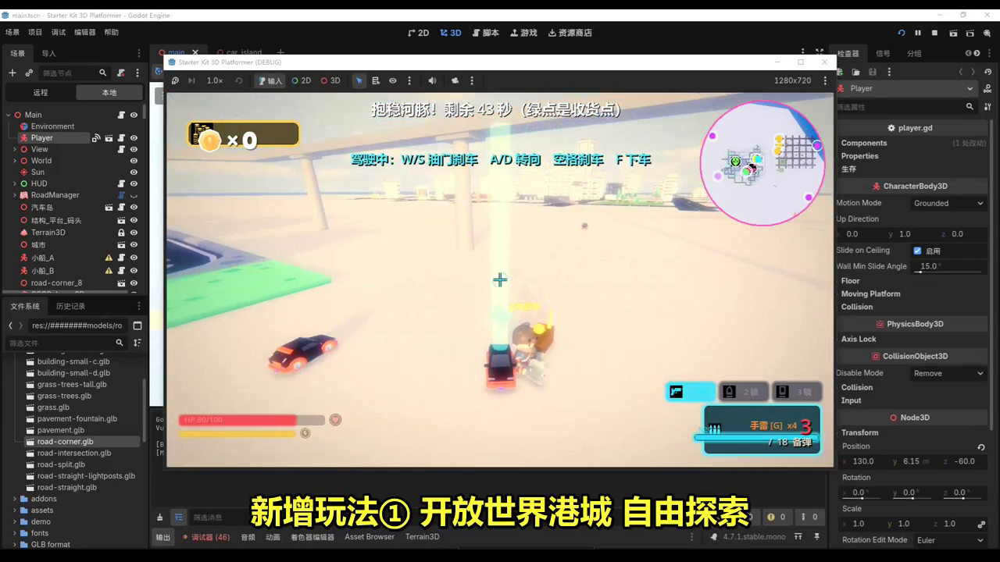
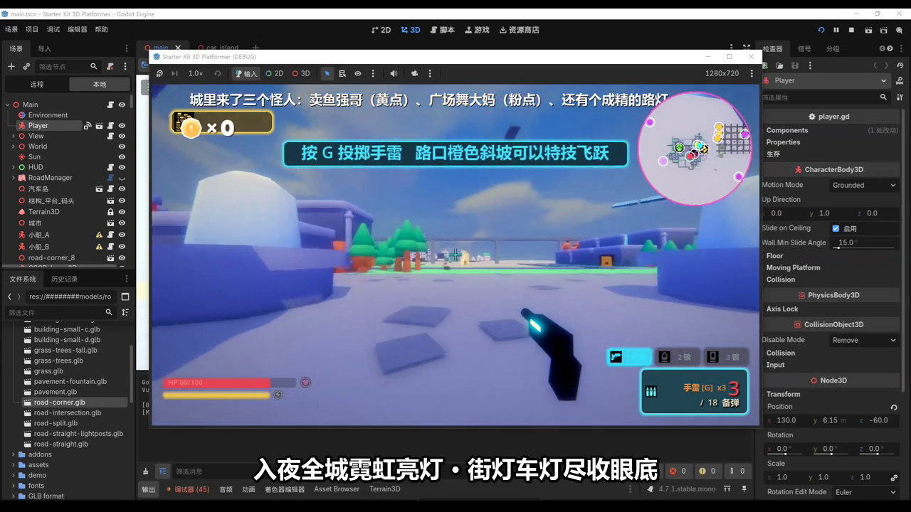
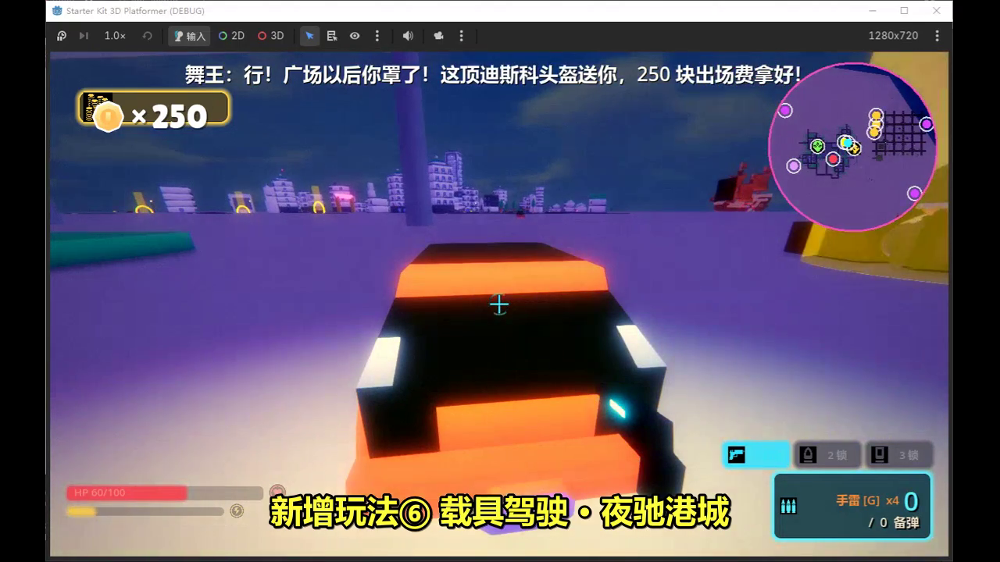

# 港城 Port-City

基于 Godot 4 的开放世界犯罪题材 3D 动作游戏（由 [Kenney Starter Kit 3D Platformer](https://github.com/KenneyNL/Starter-Kit-3D-Platformer) 深度扩展而来），纯 GDScript 实现，无 C# 依赖。

在 3D 平台模板的基础上，扩建了一座可自由探索的港口城市，并加入昼夜霓虹、载具、战斗、通缉、成就等一整套玩法。

## 玩法一览

- **开放世界探索** — 港城大街、码头据点、新区，自由漫游
- **昼夜循环** — 夜晚全城霓虹亮灯
- **光柱指引** — 城内彩色光柱标记目标点，夜间尤醒目
- **隐藏包裹收集** — 全城 20 个粉色钻石隐藏包裹，每个 500 金
- **战绩成就面板** — 金币 / 击杀 / 命中率 / 世界物资，13 个成就
- **载具驾驶** — 抢车、氮气加速（N2O）、夜驰港城、特技坡
- **手雷投掷** — 多段范围伤害判定
- **通缉追捕** — 扰民/袭击行人触发通缉
- **武器世界拾取** — 地图上拾取枪械（2 枪 3 锁）
- **斗舞节奏小游戏** — 方向键踩点，8 拍中 6 拿奖励
- **竞速 / 地铁 / 医院** — 赛事捷径、地铁换乘、死亡重生

## 截图

| | |
|---|---|
|  |  |
|  | |

## 如何运行

1. 安装 [Godot 4.7.1](https://godotengine.org/download)（标准版或 .NET/Mono 版均可，本项目为纯 GDScript）
2. 用 Godot 打开本项目根目录的 `project.godot`
3. 等待资源导入完成，按 `F5` 运行

## 操作

| 按键 | 功能 |
|---|---|
| `W A S D` | 移动 |
| `空格` | 跳跃（可二段跳） |
| `F` | 互动 / 进入载具 |
| `G` | 手雷 |
| `B` | 查看战绩与成就 |
| 方向键 / +/- | 相机旋转 / 缩放 |

## 致谢

- [Kenney](https://kenney.nl) — [Starter Kit 3D Platformer](https://github.com/KenneyNL/Starter-Kit-3D-Platformer)（MIT），本项目的基础模板；内置 2D/3D 素材与音效为 CC0
- [godot-road-generator](https://github.com/TheDudeWithCode/godot-road-generator) — 道路生成插件
- [Terrain3D](https://github.com/TokisanGames/Terrain3D) — 地形插件（详见 `addons/` 内各插件自带许可）

## 许可证

代码部分以 [MIT License](LICENSE) 开源。
